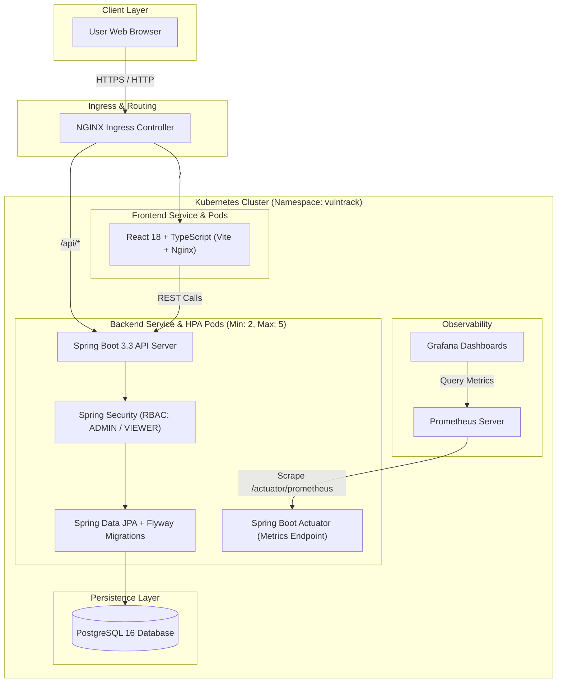

# VulnTrack — Vulnerability Tracking System

A lightweight, enterprise-grade Cybersecurity Portfolio & DevOps Capstone Project.

[](https://github.com)
[](LICENSE)
[](https://adoptium.net)
[](https://spring.io)
[](https://react.dev)

---

## 🛡️ Project Overview

**VulnTrack** is a functional vulnerability management web platform designed to satisfy university full-stack and DevOps project requirements. It provides security teams with an intuitive way to catalog software assets, register vulnerabilities with severity ratings, track remediation progress, and visualize risk exposure through a security dashboard.

The application enforces **defense-in-depth principles**, strict **Role-Based Access Control (RBAC)**, comprehensive **CI/CD quality gates**, automated **container vulnerability scanning**, **Infrastructure as Code (IaC)**, and cloud-native **Kubernetes deployment with auto-scaling and Prometheus monitoring**.

---

## 🏛️ System Architecture



---

## 🚀 Key Features

1. **Asset Management**:
   - Register software assets (Web Applications, APIs, Databases, Cloud Services).
   - Track environment tiers (`PRODUCTION`, `STAGING`, `DEVELOPMENT`).
   - Audit timestamps and descriptions.

2. **Vulnerability Tracking**:
   - Log discovered vulnerabilities with optional CVE identifiers (e.g., `CVE-2024-21626`).
   - Assign CVSS-aligned severities: `LOW`, `MEDIUM`, `HIGH`, `CRITICAL`.
   - Manage remediation status lifecycle: `OPEN` → `IN_PROGRESS` → `FIXED`.

3. **Security Posture Dashboard**:
   - High-level KPIs: Total Assets, Open Findings, Critical Vulnerabilities, Remediation Rate.
   - Severity breakdown and recent discovery audit logs.

4. **Security & DevOps Pipeline**:
   - **Authentication & RBAC**: In-memory / hashed credential authentication separating read-only `VIEWER` users from operational `ADMIN` users.
   - **Static & Dynamic Analysis**: GitHub Actions runs automated unit tests, OWASP Dependency-Check / dependency review, and GitLeaks secret scans.
   - **Trivy Container Scanning**: Docker image security scanning failing builds on high/critical container vulnerabilities.
   - **Infrastructure as Code (IaC)**: Terraform manages Kubernetes namespaces, resource quotas, and baseline configuration.
   - **Helm Deployment**: Modular, parameterized manifests with resource limits and health probes (`livenessProbe` / `readinessProbe`).
   - **Observability**: Prometheus scrapes Spring Boot Actuator `/actuator/prometheus` metrics visualized in pre-configured Grafana dashboards.

---

## 📂 Repository Structure

```
.
├── backend/                  # Java 17 / Spring Boot 3.3 REST API
│   ├── src/
│   │   ├── main/java/com/vulntrack/
│   │   │   ├── config/      # Security, CORS, OpenAPI configurations
│   │   │   ├── controller/  # REST Controllers
│   │   │   ├── dto/         # Request & Response Data Transfer Objects
│   │   │   ├── entity/      # JPA Entity models (Asset, Vulnerability)
│   │   │   ├── exception/   # Global exception handling & error responses
│   │   │   ├── repository/  # Spring Data JPA interfaces
│   │   │   └── service/     # Business logic & authorization rules
│   │   └── main/resources/
│   │       ├── db/migration # Flyway SQL migration scripts
│   │       └── application.yml
│   ├── Dockerfile           # Multi-stage non-root container build
│   └── pom.xml
├── frontend/                 # React 18 / TypeScript / Vite Single Page App
│   ├── src/
│   │   ├── components/      # UI components (Navbar, StatCards, Modals)
│   │   ├── services/        # Axios API client & typed endpoints
│   │   ├── types/           # TypeScript data interfaces
│   │   ├── App.tsx
│   │   └── main.tsx
│   ├── Dockerfile           # Multi-stage Nginx-served static build
│   └── package.json
├── docker/                   # Local container orchestration
│   └── docker-compose.yml   # Multi-service local environment (App + DB)
├── terraform/                # Infrastructure as Code (Kubernetes Provider)
│   ├── main.tf              # Namespaces, ServiceAccounts, ResourceQuotas
│   ├── variables.tf
│   └── outputs.tf
├── helm/                     # Kubernetes Helm Chart
│   └── vulntrack/
│       ├── Chart.yaml
│       ├── values.yaml
│       └── templates/       # Deployments, Services, Ingress, HPA
├── monitoring/               # Observability manifests
│   ├── prometheus/          # Scrape configs & alert rules
│   └── grafana/             # Dashboard JSON definitions
├── docs/                     # Documentation & Capstone Learning Handbook
│   ├── handbook/            # 20-chapter comprehensive student manual
│   └── threat-model.md      # STRIDE security analysis
├── .github/workflows/        # CI/CD pipelines (ci.yml)
├── .env.example              # Template environment variables
└── SECURITY.md               # Security policy & reporting guidelines
```

---

## 🛠️ Technology Stack & Versions

| Layer | Technology | Version | Rationale |
| :--- | :--- | :--- | :--- |
| **Backend** | Java (Temurin) | 17 LTS | Modern LTS standard with record support, strong ecosystem stability |
| **Framework** | Spring Boot | 3.3.x | Current production release, native Jakarta EE, Actuator Prometheus support |
| **Security** | Spring Security | 6.3.x | Robust RBAC, method security, secure header defaults |
| **Persistence** | PostgreSQL | 16-alpine | Enterprise-grade relational integrity, low resource footprint |
| **Migrations**| Flyway | 10.x | Deterministic, version-controlled database schema evolution |
| **Frontend** | React + Vite | 18.x + Vite 5 | Fast builds, lightweight footprint, strong TypeScript ecosystem |
| **Styling** | Vanilla CSS | Custom Dark | High-contrast, accessibility-focused, zero unnecessary CSS dependencies |
| **Container** | Docker | Multi-stage | Alpine/Distroless non-root images minimizing attack surface |
| **CI/CD** | GitHub Actions | Latest | Integrated GitHub security scanning, GHCR publishing |
| **Vulnerability Scanning** | Trivy | 0.50+ | Industry standard container and filesystem vulnerability scanner |
| **IaC** | Terraform | 1.8+ | Declarative Kubernetes environment orchestration |
| **Deployment**| Helm | 3.14+ | Templated, versioned Kubernetes deployment packages |
| **Orchestration**| Kubernetes (Kind/Minikube) | 1.28+ | Cloud-native standard with Ingress and Horizontal Pod Autoscaling (HPA) |
| **Monitoring**| Prometheus + Grafana | 2.50+ / 10.4+ | Gold standard cloud-native metric gathering and visualization |

---

## 🚦 Quick Start Guide

### 1. Fast Standalone Mode (No Docker Required)
You can launch VulnTrack directly on your development machine using its built-in in-memory H2 database:

```powershell
# Terminal 1: Start Backend (Port 8080)
cd backend
.\mvnw.cmd spring-boot:run

# Terminal 2: Start Frontend (Port 5173)
cd frontend
npm run dev
```

### 2. Full Containerized Stack (Docker Compose)
To launch PostgreSQL 16, Backend, and Frontend reverse-proxied together:

```powershell
cp .env.example .env
cd docker
docker compose up --build
```

### 3. Access URLs & Default Credentials

| Service | URL | Role / Notes |
| :--- | :--- | :--- |
| **Frontend UI** | `http://localhost:5173` (or `http://localhost:3000` via Docker) | React SPA with Live Role Switcher |
| **Swagger UI** | `http://localhost:8080/swagger-ui/index.html` | Interactive OpenAPI 3.0 testing console |
| **Actuator Health** | `http://localhost:8080/actuator/health` | Liveness & Readiness probe status |
| **Prometheus Metrics**| `http://localhost:8080/actuator/prometheus` | Raw telemetry scrape target |

#### Default Test Accounts:
- **Admin (Full Read/Write)**: Username: `admin` | Password: `AdminSecurePassword!2026`
- **Viewer (Read-Only)**: Username: `viewer` | Password: `ViewerReadOnlyPassword!2026`

---

## 📖 Capstone Learning Handbook

A comprehensive, 20-chapter beginner-friendly learning manual is available in [`docs/handbook/`](docs/handbook/README.md). It walks you through every layer of code, containerization, Kubernetes manifest, security scanning tool, and includes **30 College Viva Questions with Model Answers** and a **10-Slide Presentation Script** in [Chapter 19](docs/handbook/19-college-viva-and-presentation.md).

