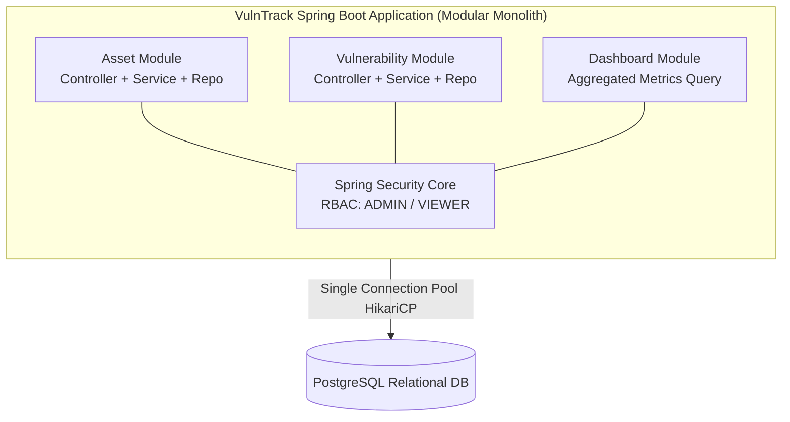
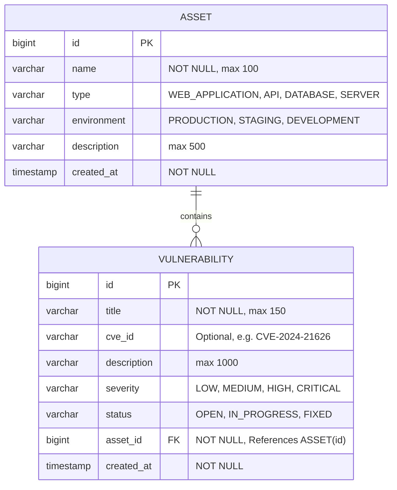
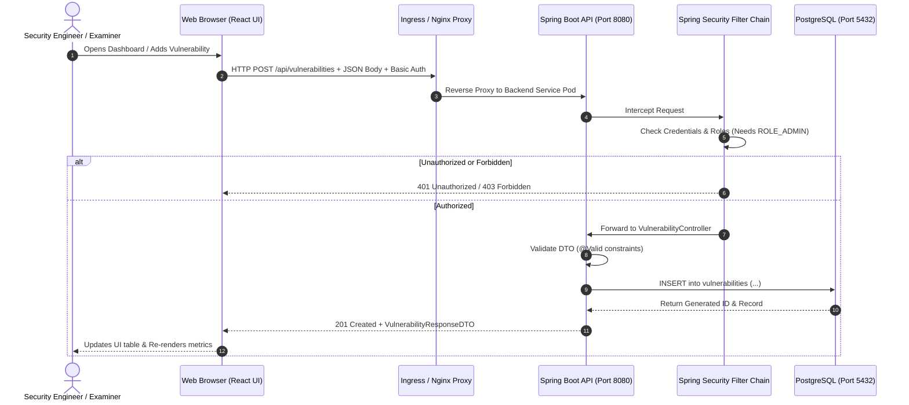

# Chapter 01: Project Overview and Architecture

## 1. What is VulnTrack?

**VulnTrack** is an enterprise-pattern, student-friendly **Vulnerability Management System**.

In real-world cybersecurity operations, organizations manage hundreds of applications, services, and cloud databases (termed **Assets**). When internal code reviews, automated security scanners (e.g., Snyk, SonarQube), or external penetration testers find security flaws, security teams need a single source of truth to:
1. Identify which asset is affected.
2. Quantify the severity of the flaw (e.g., `CRITICAL`, `HIGH`, `MEDIUM`, `LOW`).
3. Track remediation from discovery (`OPEN`) through development (`IN_PROGRESS`) to verification and resolution (`FIXED`).
4. Provide engineering leadership with high-level metrics via an executive dashboard.

VulnTrack models this essential cybersecurity workflow with clean, maintainable, production-ready code.

---

## 2. Architectural Decision: Why a Modular Monolith?

A common temptation in modern software engineering is to split even small systems into multiple microservices (e.g., "Asset Service", "Vulnerability Service", "Notification Service").

For VulnTrack, we deliberately chose a **Modular Monolith**:

### Why this is the superior engineering choice:
1. **Reduced Operational Overhead**: Microservices introduce distributed transactions, network latency, distributed logging (Jaeger/Zipkin), and complex deployment choreography.
2. **ACID Transactions**: Relational constraints (e.g., a vulnerability belonging to an asset via foreign keys) are maintained natively in PostgreSQL without complex distributed sagas.
3. **Optimized for Learning**: As a student and junior engineer, mastering clean layering (Controller → Service → Repository → Entity) in a single well-structured codebase builds the foundational mental models required before navigating distributed systems.
4. **Cloud-Native Deployment**: Although it is a monolith, it is packaged as a lightweight container and scaled horizontally using Kubernetes HPA.

---

## 3. Entity-Relationship (ER) Domain Model

The application revolves around two core domain entities:

### Key Relational Rules:
- **One-to-Many Relationship**: One `Asset` can have zero, one, or many `Vulnerabilities`.
- **Referential Integrity**: A vulnerability cannot exist without a valid parent asset (`NOT NULL` on `asset_id`).
- **Cascade Behavior**: If an asset is deleted, all associated vulnerabilities are either deleted concurrently (`CASCADE`) or prevented from deletion if unresolved (we enforce safe programmatic verification).

---

## 4. End-to-End System Architecture

---

## 5. Technology Selection & Version Compatibility

| Component | Selected Version | Reason & Compatibility Notes |
| :--- | :--- | :--- |
| **Java** | 17 (Eclipse Temurin) | Long-Term Support (LTS). Compatible with Spring Boot 3.3.x. Includes modern records and pattern matching. |
| **Spring Boot** | 3.3.x | Uses Jakarta EE 10 namespaces (`jakarta.persistence.*`, `jakarta.validation.*`). Built-in Micrometer Prometheus support. |
| **PostgreSQL** | 16-alpine | Alpine-based image reduces size from ~400MB to ~80MB, minimizing container attack surface. |
| **Node.js** | 20+ LTS / 22 Current | Standard Node runtime for Vite compilation. |
| **React** | 18.3.x | Stable hook-based architecture (`useState`, `useEffect`). Predictable UI rendering. |
| **Vite** | 5.x | Instant development server start via native ES modules, highly optimized production rollups. |
| **Docker** | Multi-stage | Builder stage compiles artifacts; runner stage uses minimal JRE/Nginx image without build tools. |
| **Kubernetes** | 1.28+ | Compatible with standard Kind/Minikube local clusters and Helm 3. |

In the next chapter, we will explore the project's folder layout and trace a live HTTP request through every layer of the backend and frontend.
