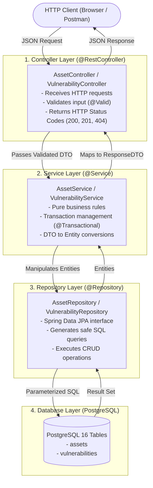
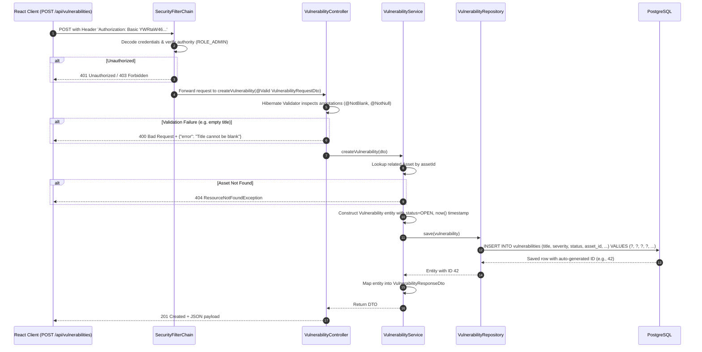

# Chapter 02: Repository Structure and Request Flow

Understanding how a codebase is organized is the first step toward understanding how an enterprise system works. In this chapter, we explore the file layout of VulnTrack and trace the exact lifecycle of a network request from the browser to PostgreSQL and back.

---

## 1. Directory Anatomy

A professional full-stack repository maintains a clean separation between application source code, infrastructure, and deployment configurations:

```
vulntrack/
├── backend/                       # Spring Boot Java application
│   ├── src/
│   │   ├── main/
│   │   │   ├── java/com/vulntrack/
│   │   │   │   ├── config/        # SecurityFilterChain, WebMvc CORS, OpenApi
│   │   │   │   ├── controller/    # REST endpoints (HTTP handling)
│   │   │   │   ├── dto/           # Request and Response transfer records
│   │   │   │   ├── entity/        # Database JPA entities
│   │   │   │   ├── exception/     # Global error handling (@ControllerAdvice)
│   │   │   │   ├── repository/    # Spring Data JPA interfaces
│   │   │   │   ├── service/       # Business logic layer
│   │   │   │   └── VulnTrackApplication.java # Spring Boot entry point
│   │   │   └── resources/
│   │   │       ├── application.yml           # Core config
│   │   │       ├── application-docker.yml    # Container-specific overrides
│   │   │       └── db/migration/             # Flyway SQL migrations (V1, V2...)
│   │   └── test/java/com/vulntrack/          # JUnit 5 & Mockito test suites
│   ├── Dockerfile                 # Multi-stage Docker build
│   └── pom.xml                    # Maven dependency tree
│
├── frontend/                      # React 18 + TypeScript + Vite SPA
│   ├── src/
│   │   ├── components/            # Reusable UI widgets (Navbar, StatCard, AssetModal)
│   │   ├── services/              # Axios HTTP client configuration
│   │   ├── types/                 # TypeScript interfaces (Asset, Vulnerability)
│   │   ├── App.tsx                # Master page layout and state coordinating
│   │   ├── index.css              # Dark-mode styling and animations
│   │   └── main.tsx               # React root renderer
│   ├── Dockerfile                 # Multi-stage build (Node build -> Nginx host)
│   └── package.json               # Frontend dependencies & scripts
│
├── docker/                        # Local developer composition
│   └── docker-compose.yml         # Postgres + Backend + Frontend one-click spinup
│
├── terraform/                     # Infrastructure as Code
│   ├── main.tf                    # Manages namespace, resource quotas, service accounts
│   ├── variables.tf
│   └── outputs.tf
│
├── helm/                          # Helm Kubernetes packaging
│   └── vulntrack/
│       ├── Chart.yaml
│       ├── values.yaml            # Environment parameter overrides
│       └── templates/             # Deployments, Services, Ingress, HPA
│
├── monitoring/                    # Observability setup
│   ├── prometheus/                # Prometheus configuration and alerting rules
│   └── grafana/                   # Pre-configured dashboard JSONs
│
└── docs/                          # Architecture guides & student handbook
```

---

## 2. The Layered Backend Architecture

Why not just write database queries directly inside the HTTP controller?

In software engineering, mixing HTTP parsing, database access, and validation creates fragile "spaghetti code." VulnTrack enforces the **Separation of Concerns (SoC)** principle using four distinct layers:



---

## 3. Why We Never Expose JPA Entities Directly (The DTO Pattern)

A critical security and architectural best practice is: **Never return your database `@Entity` classes directly from your REST controllers.**

Instead, we use **DTOs (Data Transfer Objects)**:
- `AssetRequestDto` / `AssetResponseDto`
- `VulnerabilityRequestDto` / `VulnerabilityResponseDto`

### Dangers of returning Entities directly:
1. **Accidental Information Disclosure**: An entity might contain internal database flags, audit user IDs, or sensitive columns. If a new column is added to the database, it would be instantly leaked in API responses unless DTOs isolate the contract.
2. **Infinite Recursion**: If `Asset` has `List<Vulnerability>` and `Vulnerability` has `Asset`, Jackson JSON serialization will enter an infinite loop and throw a `StackOverflowError`.
3. **Mass Assignment Vulnerability**: When receiving JSON input directly into an entity, an attacker can supply fields like `"id": 1` or `"created_at": "1999-01-01"` to tamper with protected fields. DTOs restrict incoming data strictly to permissible fields (e.g., `name`, `type`, `description`).

---

## 4. Tracing a Request End-to-End: `POST /api/vulnerabilities`

Let us trace what happens when an administrator creates a vulnerability:



In Chapter 04 and 05, we will build out the exact Java classes and SQL migrations powering this lifecycle.
