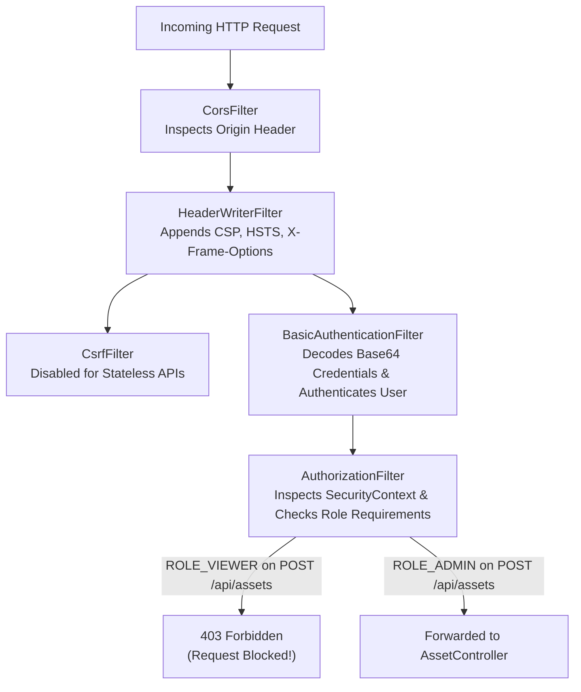

# Chapter 07: Authentication, RBAC & Application Security (AppSec)

Security is the core identity of VulnTrack. Rather than treating security as an afterthought, VulnTrack enforces the **Principle of Least Privilege (PoLP)** and **Defense-in-Depth** across every layer.

---

## 1. Authentication vs. Authorization

Understanding this distinction is one of the most common questions in university viva exams:

| Concept | Definition | Example in VulnTrack | HTTP Failure Code |
| :--- | :--- | :--- | :--- |
| **Authentication (AuthN)** | *"Who are you?"* Verifying identity via valid credentials. | Submitting `Basic YWRtaW46...` with matching BCrypt password. | **`401 Unauthorized`** |
| **Authorization (AuthZ)** | *"What are you allowed to do?"* Checking roles and permissions after identity is confirmed. | A user with `ROLE_VIEWER` trying to `DELETE /api/assets/1`. | **`403 Forbidden`** |

---

## 2. The Spring Security Filter Chain

In Spring Boot 3, security is governed by a chain of servlet filters that intercept every incoming HTTP request before it reaches our `@RestController`:



### VulnTrack Configuration (`SecurityConfig.java`):

```java
@Bean
public SecurityFilterChain securityFilterChain(HttpSecurity http) throws Exception {
    http
        .csrf(AbstractHttpConfigurer::disable)
        .cors(cors -> cors.configurationSource(corsConfigurationSource()))
        .sessionManagement(session -> session.sessionCreationPolicy(SessionCreationPolicy.STATELESS))
        .headers(headers -> headers
            .contentTypeOptions(Customizer.withDefaults())
            .frameOptions(HeadersConfigurer.FrameOptionsConfig::deny)
            .httpStrictTransportSecurity(hsts -> hsts.includeSubDomains(true).maxAgeInSeconds(31536000))
        )
        .authorizeHttpRequests(auth -> auth
            .requestMatchers("/actuator/health/**", "/actuator/info", "/actuator/prometheus").permitAll()
            .requestMatchers(HttpMethod.GET, "/api/**").hasAnyRole("VIEWER", "ADMIN")
            .requestMatchers(HttpMethod.POST, "/api/**").hasRole("ADMIN")
            .requestMatchers(HttpMethod.PUT, "/api/**").hasRole("ADMIN")
            .requestMatchers(HttpMethod.PATCH, "/api/**").hasRole("ADMIN")
            .requestMatchers(HttpMethod.DELETE, "/api/**").hasRole("ADMIN")
            .anyRequest().authenticated()
        )
        .httpBasic(Customizer.withDefaults());

    return http.build();
}
```

---

## 3. Cryptographic Password Hashing (BCrypt)

Passwords should **never** be stored or compared in plain text:
- Plaintext passwords or simple SHA-256 hashes are vulnerable to rainbow tables and brute-force GPU cracking.
- VulnTrack uses **BCrypt with a work factor of 12** (`new BCryptPasswordEncoder(12)`):
  - BCrypt automatically generates a cryptographically random salt.
  - The exponential cost factor (12 = $2^{12} = 4096$ rounds) intentionally slows down hash computations to make offline cracking computationally infeasible.

---

## 4. Input Boundary Validation (Bean Validation JSR-380)

To prevent parameter tampering, denial of service, and invalid data entry, request DTOs are validated at the controller boundary:

```java
public record VulnerabilityRequestDto(
    @NotBlank(message = "Title is required")
    @Size(max = 150, message = "Title must not exceed 150 characters")
    String title,

    @Pattern(regexp = "^$|^CVE-\\d{4}-\\d{4,7}$", message = "CVE ID must be blank or follow standard format (e.g., CVE-2024-21626)")
    String cveId,

    @NotNull(message = "Severity is required")
    Severity severity,

    @NotNull(message = "Associated asset ID is required")
    Long assetId
) {}
```

If a client sends an empty title or an invalid CVE identifier (e.g., `"CVE-MALICIOUS"`), Spring throws a `MethodArgumentNotValidException`, which our `GlobalExceptionHandler` converts into a structured `400 Bad Request` without executing any database queries.
