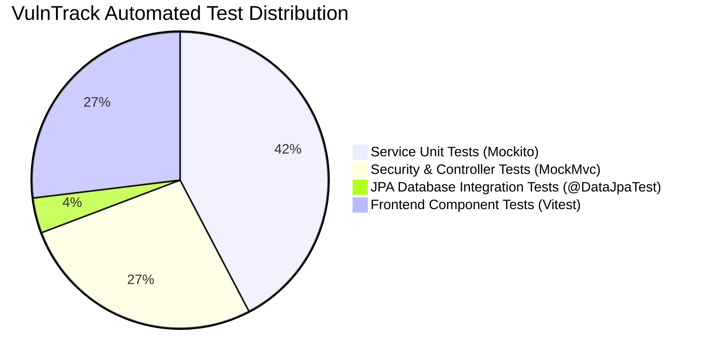

# Chapter 08: Automated Testing Strategy (Backend & Frontend)

In professional DevOps environments, automated tests act as **quality gates** in CI/CD pipelines. If any test fails, the build breaks immediately, preventing broken or vulnerable code from reaching production.

---

## 1. The Test Pyramid in VulnTrack



1. **Unit Tests (Fast, Isolated)**: Test individual methods in isolation by mocking external dependencies with Mockito.
2. **Integration Tests (Slice Testing)**: Bootstraps JPA or Spring Security slices to test database constraints and filter chains.
3. **Frontend Component Tests (User-Centric)**: Tests UI widgets, state updates, and accessibility roles using React Testing Library.

---

## 2. Testing Spring Security with MockMvc & `@WithMockUser`

In [SecurityAuthorizationTest.java](file:///c:/Users/LENOVO/Documents/Desktop/desk/3rd%20year/Devops/Devops%20Project/backend/src/test/java/com/vulntrack/controller/SecurityAuthorizationTest.java), we test RBAC enforcement without spinning up a live network server:

```java
@Test
@WithMockUser(username = "viewer", roles = {"VIEWER"})
@DisplayName("VIEWER role attempting POST /api/assets must be rejected with 403 Forbidden")
void viewerRole_cannotCreateAsset_shouldReturn403Forbidden() throws Exception {
    AssetRequestDto request = new AssetRequestDto(
        "New Database",
        AssetType.DATABASE,
        Environment.STAGING,
        "Description"
    );

    mockMvc.perform(post("/api/assets")
            .contentType(MediaType.APPLICATION_JSON)
            .content(objectMapper.writeValueAsString(request)))
        .andExpect(status().isForbidden());
}
```

This test guarantees that even if a frontend developer accidentally enables a "Create" button for a viewer, the backend authorization filter will reject the mutating HTTP request with `403 Forbidden`.

---

## 3. Database Integration Testing with `@DataJpaTest`

In [VulnerabilityRepositoryIntegrationTest.java](file:///c:/Users/LENOVO/Documents/Desktop/desk/3rd%20year/Devops/Devops%20Project/backend/src/test/java/com/vulntrack/repository/VulnerabilityRepositoryIntegrationTest.java), we verify relational mapping against an actual database:

```java
@DataJpaTest
@ActiveProfiles("dev")
class VulnerabilityRepositoryIntegrationTest {

    @Autowired
    private AssetRepository assetRepository;

    @Autowired
    private VulnerabilityRepository vulnerabilityRepository;

    @Test
    void testAssetAndVulnerabilityPersistence() {
        Asset asset = new Asset("Payment Gateway", AssetType.API, Environment.PRODUCTION, "Desc");
        Asset savedAsset = assetRepository.save(asset);

        Vulnerability vuln = new Vulnerability(
            "SQL Injection", "CVE-2023-12345", "Desc",
            Severity.CRITICAL, VulnerabilityStatus.OPEN, savedAsset
        );
        vulnerabilityRepository.save(vuln);

        List<Vulnerability> results = vulnerabilityRepository.searchVulnerabilities(
            savedAsset.getId(), Severity.CRITICAL, VulnerabilityStatus.OPEN
        );

        assertThat(results).hasSize(1);
    }
}
```

---

## 4. How to Run the Test Suites Locally

### Run Backend Tests (Maven):
```powershell
cd backend
.\mvnw.cmd test
```

### Run Frontend Tests (Vitest):
```powershell
cd frontend
npm test
```

### Run Production Frontend Build Check:
```powershell
cd frontend
npm run build
```
