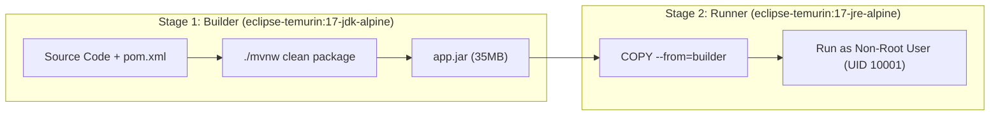

# Chapter 09: Docker & Docker Compose Containerization

Containers allow developers to package an application alongside all its operating system dependencies, ensuring the classic developer dilemma — *"It works on my machine!"* — is completely eliminated.

---

## 1. Why Multi-Stage Docker Builds?

In naive Dockerfiles, developers compile their applications inside the container using full SDKs (like JDK or Node). This leaves Maven, compilers, source code, and temporary files in the final image, resulting in massive image sizes (> 600MB) with bloated attack surfaces.

VulnTrack uses **Multi-Stage Builds**:



### Benefits:
1. **Dramatically Smaller Image**: The builder stage with JDK and build tools is discarded; only the minimal JRE and the single JAR are kept (~150MB total).
2. **Reduced Attack Surface**: Attackers cannot find compilers, package managers, or source code inside the production container.

---

## 2. Hardening Containers: Non-Root Execution

By default, Docker containers run as `root` (`UID 0`). If an attacker finds a remote code execution vulnerability (e.g., Log4j) in a container running as root, they might escape the container and achieve root access over the host machine!

In [backend/Dockerfile](file:///c:/Users/LENOVO/Documents/Desktop/desk/3rd%20year/Devops/Devops%20Project/backend/Dockerfile), we enforce non-root execution:

```dockerfile
# Create system group and user
RUN addgroup --system --gid 10001 appgroup && \
    adduser --system --uid 10001 --ingroup appgroup --no-create-home appuser

# Set ownership
RUN chown -R appuser:appgroup /app

# Switch to non-root UID
USER 10001
```

---

## 3. Local Development with Docker Compose

In [docker/docker-compose.yml](file:///c:/Users/LENOVO/Documents/Desktop/desk/3rd%20year/Devops/Devops%20Project/docker/docker-compose.yml), three services are wired together on a private virtual bridge network:
1. **`postgres`**: Runs PostgreSQL 16 Alpine with healthcheck `pg_isready`.
2. **`backend`**: Waits for PostgreSQL to be healthy (`condition: service_healthy`) before launching.
3. **`frontend`**: Serves the compiled React SPA through NGINX and proxies `/api/` calls to `backend:8080`.

### Running Locally:
```powershell
cd docker
docker compose up --build
```
The entire application will be accessible at `http://localhost:3000` with PostgreSQL data persisted across restarts in the `vulntrack_postgres_data` volume.
