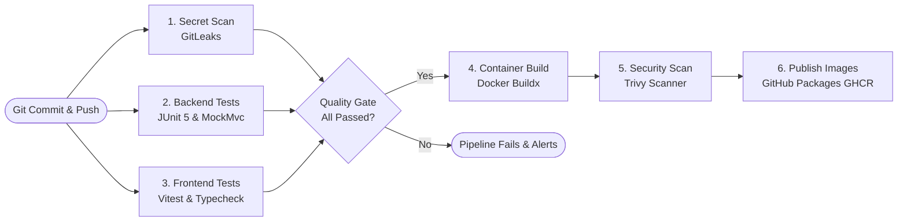

# Chapter 10: GitHub Actions & CI/CD Pipeline Automation

Continuous Integration and Continuous Deployment (CI/CD) automates the validation, packaging, and delivery of software upon every code commit.

---

## 1. CI/CD Lifecycle in VulnTrack



---

## 2. Principle of Least Privilege in CI/CD

Workflows should only have the minimal GitHub permissions needed to complete their task:

```yaml
permissions:
  contents: read          # Read repository code
  packages: write         # Publish container images to GHCR
  security-events: write  # Upload SARIF vulnerability reports to Security tab
```

Never grant administrative write permissions to all scopes if only package publishing is required.

---

## 3. Dependency Caching for Fast Pipelines

In cloud runners, downloading dependencies from scratch on every run wastes minutes. In `.github/workflows/ci.yml`, we leverage caching:
- For Java: `cache: maven` in `actions/setup-java@v4` reuses cached `~/.m2/repository` jars.
- For Node: `cache: npm` in `actions/setup-node@v4` caches `~/.npm` packages.

This reduces pipeline execution time from ~7 minutes to under 2 minutes.
