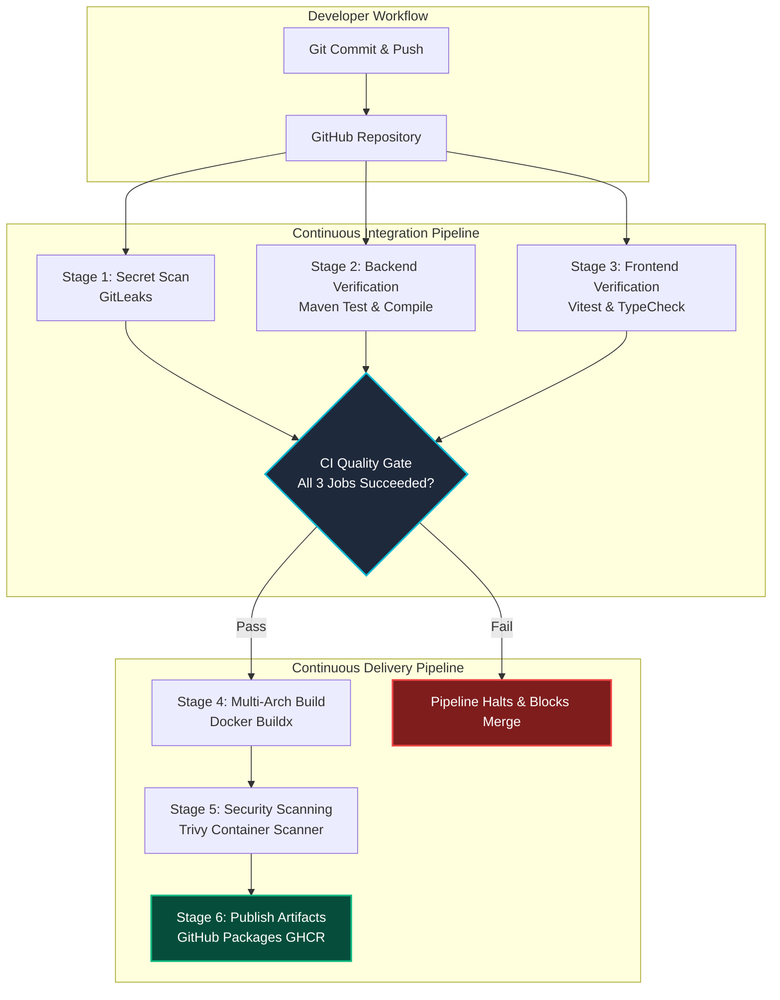

# Chapter 10: GitHub Actions & CI/CD Pipeline Automation

Continuous Integration and Continuous Deployment (CI/CD) automates the validation, packaging, testing, and delivery of software upon every code commit. In modern DevOps, manual testing and manual container builds are considered anti-patterns because human error leads to downtime, untracked bugs, and security vulnerabilities reaching production.

---

## 1. What is CI/CD?

- **Continuous Integration (CI)**: The automated practice where developers frequently commit code to a shared repository (e.g., GitHub). Every push or pull request automatically triggers automated build tools, linters, unit tests, integration tests, and security scans. If any check fails, the pipeline halts immediately, preventing broken code from merging.
- **Continuous Delivery / Deployment (CD)**: The automated process where code that passes all CI quality gates is packaged (e.g., containerized into Docker images) and prepared for deployment to staging or production environments (e.g., Kubernetes clusters).



---

## 2. Deep Dive: VulnTrack Workflow Architecture (`.github/workflows/ci.yml`)

The VulnTrack pipeline runs in a GitHub-hosted Ubuntu runner (`ubuntu-latest`) whenever code is pushed to `master` or submitted in a Pull Request.

### A. The Principle of Least Privilege in CI/CD

By default, older CI pipelines had broad write access to repositories. In accordance with NIST and OWASP supply chain security standards, VulnTrack enforces explicit, minimal permissions:

```yaml
permissions:
  contents: read          # Read git repository source code only
  packages: write         # Push Docker images to GitHub Container Registry (GHCR)
  security-events: write  # Upload SARIF security scanner reports to GitHub Security Tab
```

> **Why this matters for security**: If an external dependency or build step is compromised, an attacker cannot delete branches, rewrite repository history, or modify pull request comments because the pipeline token lacks those capabilities.

---

## 3. Pipeline Stages Broken Down

### Stage 1: Secret Scanning with GitLeaks
Hardcoded passwords, API keys, or private SSH keys must never enter a Git history. GitLeaks executes before any compilation:
```yaml
- name: Run GitLeaks Secret Scanner
  uses: gitleaks/gitleaks-action@v2
  env:
    GITHUB_TOKEN: ${{ secrets.GITHUB_TOKEN }}
```
If a developer accidentally leaves `db_password="SuperSecret123!"` in a source file, GitLeaks fails the job instantly.

### Stage 2: Java Backend Verification
Executes standard unit and integration tests using JUnit 5, Mockito, and Spring Boot Test:
```yaml
- name: Set up JDK 17
  uses: actions/setup-java@v4
  with:
    java-version: '17'
    distribution: 'temurin'
    cache: 'maven' # Caches ~/.m2 to speed up builds from 5m to 40s!

- name: Run Backend Tests & Verification
  run: |
    cd backend
    mvn test --batch-mode
```

### Stage 3: Frontend TypeScript & Unit Tests
Verifies JavaScript/TypeScript types and executes headless Vitest component tests:
```yaml
- name: Set up Node.js 20
  uses: actions/setup-node@v4
  with:
    node-version: '20'
    cache: 'npm'
    cache-dependency-path: frontend/package-lock.json

- name: Install & Run Frontend Tests
  run: |
    cd frontend
    npm ci
    npm test -- --run --pool=forks
    npm run build
```

### Stage 4: Docker Container Build & Caching
Uses GitHub Buildx and Docker Layer Caching (`type=gha`):
```yaml
- name: Build and Push Docker Image
  uses: docker/build-push-action@v5
  with:
    context: ./backend
    push: false
    tags: ghcr.io/${{ github.repository }}/backend:${{ github.sha }}
    cache-from: type=gha
    cache-to: type=gha,mode=max
```
> **What is `npm ci` vs `npm install`?**
> Always use `npm ci` in CI pipelines! `npm install` can update `package-lock.json` and install minor/patch updates dynamically. `npm ci` performs an exact, deterministic installation matching the lock file byte-for-byte.

---

## 4. Failure Modes & How to Debug CI Jobs

| Scenario | Symptom in GitHub Actions | Root Cause & Resolution |
| :--- | :--- | :--- |
| **Flaky Test** | Tests pass locally on Windows but fail on Ubuntu runner | Case-sensitive file paths or timezone issues. Use UTC and relative paths. |
| **Dependency Timeout** | `Could not resolve dependencies from central` | Network congestion on Maven Central; Maven cache prevents this on repeat runs. |
| **Permission Denied (403 GHCR)** | `denied: installation not allowed to Create organization package` | Workflow lacks `packages: write` permission in the `permissions:` block. |
| **Memory Exhaustion (OOM)** | Process killed with Exit Code 137 | GitHub runners provide 7 GB RAM. Vitest or Maven heap exceeded limit; configure `MAVEN_OPTS="-Xmx1024m"`. |

---

## 5. Viva & Interview Questions on CI/CD

1. **Q: Why do we separate the build stage from the test stage?**
   - **Answer**: Fast feedback loops. Unit tests should run first in parallel to catch logic bugs in under a minute before dedicating heavy CPU time and disk I/O to building multi-gigabyte Docker container images.
2. **Q: How does dependency caching work in GitHub Actions?**
   - **Answer**: GitHub hashes the dependency lock file (`pom.xml` or `package-lock.json`). If the hash hasn't changed since the previous run, the runner restores the pre-downloaded archive (`~/.m2` or `~/.npm`) directly from GitHub's internal cache storage, avoiding redundant network downloads.
3. **Q: What is a SARIF file?**
   - **Answer**: Static Analysis Results Interchange Format. A standardized JSON-based format (OASIS standard) used by scanners like Trivy and GitLeaks to report code and container vulnerabilities directly into GitHub's Native CodeQL & Security dashboard.
