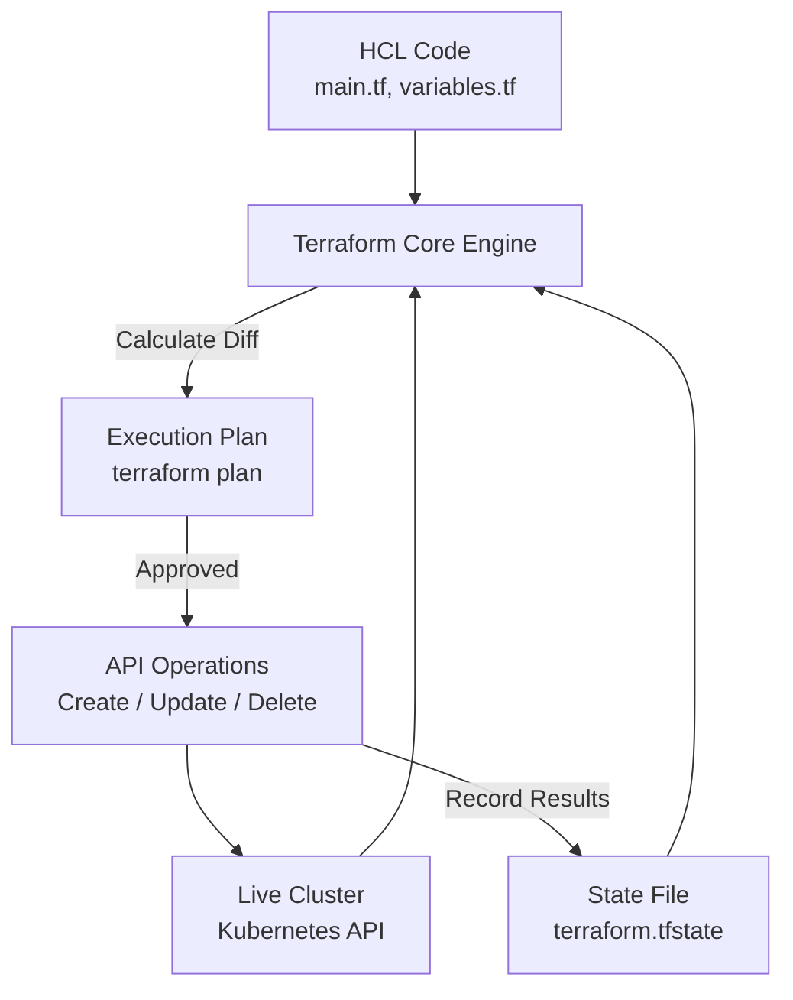

# Chapter 13: Terraform & Infrastructure as Code (IaC)

Infrastructure as Code (IaC) is the practice of provisioning, managing, and versioning cloud and cluster infrastructure using machine-readable configuration files rather than manual interactive console clicks or ad-hoc terminal commands.

---

## 1. Why Use Terraform for Kubernetes?

In many academic projects, students manage clusters by typing manual commands:
```bash
kubectl create namespace vulntrack
kubectl create serviceaccount vulntrack-sa -n vulntrack
```

### Critical Flaws with Manual `kubectl`:
1. **Imperative & Non-Idempotent**: If you run `kubectl create namespace vulntrack` a second time, it crashes with `Error from server (AlreadyExists)`. Scripts quickly become brittle with repetitive `if ! kubectl get ns ...` checks.
2. **No State Tracking**: `kubectl` does not maintain a state ledger of what resources *should* exist versus what was deleted by a rogue operator.
3. **No Drift Detection**: If someone accidentally modifies a namespace resource quota in the cluster, manual tools cannot detect or revert that change.

### The Terraform Solution
**Terraform** is **declarative**. You define the desired end-state in HashiCorp Configuration Language (HCL). Terraform's core engine queries the Kubernetes API, calculates a mathematical diff (the `plan`), and executes only the minimal operations required to bring reality in alignment with your code (`apply`).



---

## 2. Infrastructure vs. Application Separation

A foundational principle in enterprise DevOps is the **Separation of Concerns between Platform Infrastructure and Application Workloads**:

| Layer | Tool Used | Managed Resources in VulnTrack | Team Ownership |
| :--- | :--- | :--- | :--- |
| **Platform Baseline** | **Terraform** | `kubernetes_namespace`, `kubernetes_resource_quota`, `kubernetes_limit_range`, `kubernetes_service_account` | Platform / SRE Team |
| **Application Workloads** | **Helm** | Deployments, ClusterIP Services, ConfigMaps, Secrets, Ingress Routes, HPA | Application / Dev Team |

### Why This Separation Protects You:
If an application developer makes an error in a Helm chart and runs `helm uninstall`, it only removes the application pods and services. The underlying namespace, security boundaries, resource quotas, and RBAC service accounts created by Terraform remain intact and protected.

---

## 3. Deep Dive into VulnTrack Terraform Baseline (`terraform/main.tf`)

### 1. The Kubernetes Namespace (`kubernetes_namespace`)
Establishes an isolated virtual cluster boundary for VulnTrack, preventing multi-tenant interference.

### 2. The Resource Quota (`kubernetes_resource_quota`)
Prevents a "noisy neighbor" or memory leak from starving node resources:
```hcl
resource "kubernetes_resource_quota" "vulntrack_quota" {
  metadata {
    name      = "vulntrack-quota"
    namespace = kubernetes_namespace.vulntrack.metadata[0].name
  }
  spec {
    hard = {
      "requests.cpu"    = "2000m"  # Max 2 CPU cores reserved across all pods
      "requests.memory" = "2Gi"    # Max 2 GiB RAM reserved
      "limits.cpu"      = "4000m"  # Hard cap: 4 CPU cores
      "limits.memory"   = "4Gi"    # Hard cap: 4 GiB RAM
      "pods"            = "15"     # Max 15 running pods
    }
  }
}
```

### 3. The Limit Range (`kubernetes_limit_range`)
Guarantees that any pod deployed into the namespace automatically receives default requests and limits if the developer forgets to specify them in their container spec:
- Default Request: `100m` CPU, `128Mi` RAM.
- Default Limit: `500m` CPU, `512Mi` RAM.

---

## 4. Understanding Terraform State (`terraform.tfstate`)

The state file is Terraform's single source of truth. It maps the HCL resources defined in code to the real UUIDs returned by the Kubernetes API.

### State File Lifecycle:
- **`terraform init`**: Downloads the provider plugin (`hashicorp/kubernetes`) into `.terraform/` and initializes state backends.
- **`terraform plan`**: Queries the live cluster (via `kubeconfig`), reads `terraform.tfstate`, and outputs an execution plan (+ to create, ~ to modify, - to destroy).
- **`terraform apply`**: Executes the API calls and updates `terraform.tfstate`.
- **`terraform refresh`**: Synchronizes local state with real-world infrastructure to identify drift.

> **CRITICAL SECURITY NOTE**: Never commit `terraform.tfstate` to Git! State files can contain plain-text database passwords, API tokens, and private keys. In our repository, `terraform.tfstate*` is strictly excluded via [`.gitignore`](file:///c:/Users/LENOVO/Documents/Desktop/desk/3rd%20year/Devops/Devops%20Project/.gitignore). In enterprise setups, remote state backends (AWS S3 with DynamoDB locking, Terraform Cloud, or HashiCorp Consul) are used with encryption at rest.

---

## 5. Step-by-Step Hands-On Execution

### Step 1: Initialize Provider
```powershell
cd terraform
terraform init
```
*Expected Output*: `Terraform has been successfully initialized!`

### Step 2: Validate Formatting & Syntax
```powershell
terraform fmt -check
terraform validate
```
*Expected Output*: `Success! The configuration is valid.`

### Step 3: Inspect Planned Changes
```powershell
terraform plan
```
*Expected Output*: `Plan: 4 to add, 0 to change, 0 to destroy.`

### Step 4: Apply Configuration
```powershell
terraform apply -auto-approve
```
*Expected Output*: `Apply complete! Resources: 4 added, 0 changed, 0 destroyed.`

### Step 5: Verify via `kubectl`
```powershell
kubectl get namespace vulntrack
kubectl describe quota vulntrack-quota -n vulntrack
```

---

## 6. Viva & Interview Questions on Terraform

1. **Q: What is the difference between Declarative and Imperative IaC?**
   - **Answer**:
     - **Declarative (Terraform, Kubernetes YAML)**: You describe *what* the desired end-state should be. The engine figures out the steps to achieve it.
     - **Imperative (Bash, Python, Ansible tasks)**: You write explicit step-by-step instructions (*how*) to create resources sequentially.
2. **Q: What is Infrastructure Drift?**
   - **Answer**: When real-world infrastructure changes outside of Terraform (e.g., an engineer modifies a resource via the cloud console or `kubectl edit`). Running `terraform plan` detects this drift and proposes changes to restore the declared state.
3. **Q: What is the purpose of `terraform.lock.hcl`?**
   - **Answer**: It is a dependency lock file that records the exact provider version and cryptographic checksums to ensure reproducible executions across team members and CI runners.
