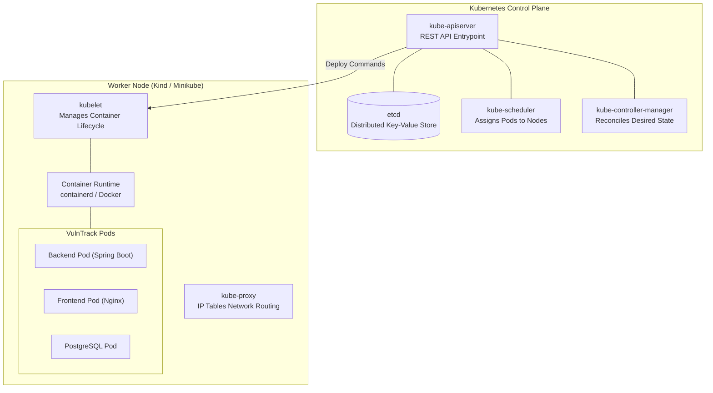

# Chapter 14: Kubernetes Fundamentals & Cloud-Native Workloads

Kubernetes is the gold standard container orchestration system, automating the deployment, scaling, self-healing, and networking of containerized applications.

---

## 1. Kubernetes Architecture in a Nutshell

---

## 2. Core Kubernetes Workload Objects

1. **Pod**: The smallest deployable computing unit. Encapsulates one or more containers sharing network namespaces (IP address) and storage volumes.
2. **Deployment**: Manages declarative replica sets, automated rolling updates, and rollbacks. If a node crashes, the Deployment controller automatically schedules replacement pods on surviving nodes.
3. **Service (ClusterIP)**: Provides a stable virtual IP address and DNS name (e.g., `http://vulntrack-backend:8080`) that load balances traffic across ephemeral backend pods.
4. **ConfigMap & Secret**: Injects configuration files and sensitive environment credentials (`POSTGRES_PASSWORD`) into pods at runtime without baking them into images.

---

## 3. High-Reliability Probes (Liveness & Readiness)

Without probes, Kubernetes assumes a pod is healthy as long as its main process hasn't exited, even if the database connection hung or a JVM memory leak caused an unresponsive deadlock!

### Spring Boot Actuator Probes:
- **`readinessProbe`** (`/actuator/health/readiness`):
  Checks if the application is fully started and ready to receive user requests. Traffic is routed to the pod only when this returns HTTP 200.
- **`livenessProbe`** (`/actuator/health/liveness`):
  Continuously pings the application. If the JVM deadlocks or becomes unresponsive, kubelet kills the broken container and restarts a fresh one.
