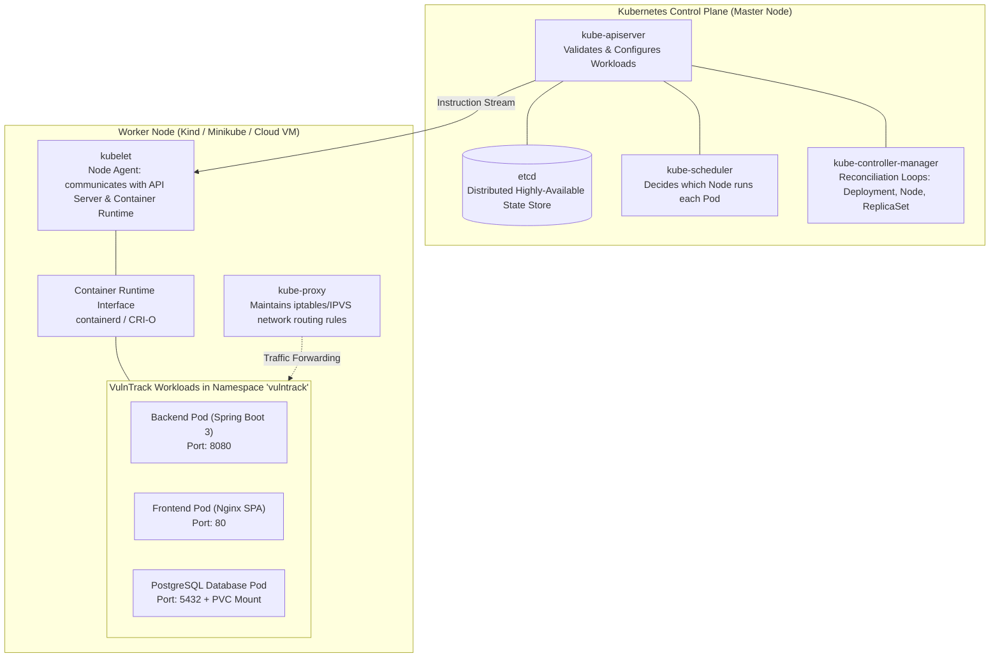
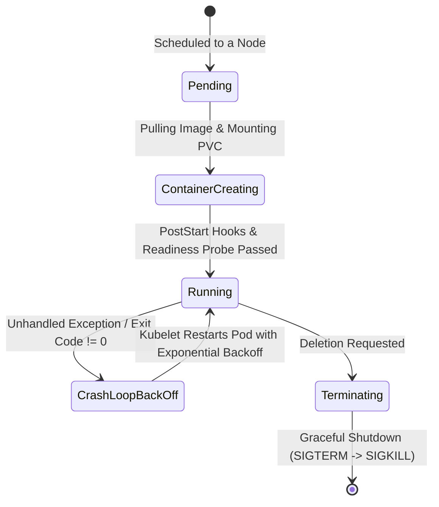
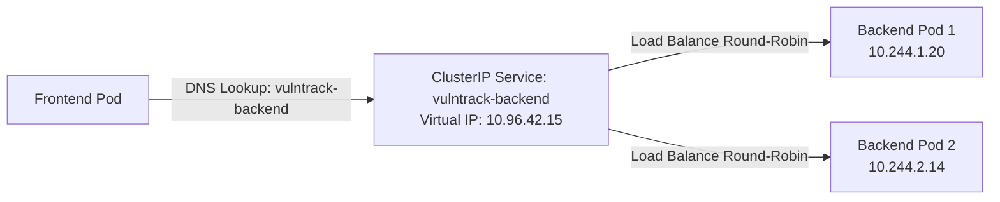

# Chapter 14: Kubernetes Fundamentals & Cloud-Native Workloads

Kubernetes (K8s) is the industry standard container orchestration engine, automating the deployment, scaling, self-healing, service discovery, and networking of containerized microservices and web applications.

---

## 1. Kubernetes Architecture in Depth

A Kubernetes cluster consists of two distinct tiers: the **Control Plane** (the brains) and one or more **Worker Nodes** (the muscle).



### Control Plane Components:
- **`kube-apiserver`**: The front-door JSON/REST API that processes all `kubectl` requests and authenticates calls.
- **`etcd`**: A distributed, consistent key-value store that holds the entire cluster state.
- **`kube-scheduler`**: Inspects unscheduled pods and chooses the best node based on CPU/RAM requests, affinities, and taints.
- **`kube-controller-manager`**: Continuous control loops that watch the cluster state and move it toward the desired state.

### Worker Node Components:
- **`kubelet`**: The primary node daemon that ensures containers described in `PodSpecs` are running and healthy.
- **`kube-proxy`**: Manages network rules on host nodes to enable Kubernetes Service communication.
- **`containerd`**: The low-level container runtime that downloads images and starts container processes.

---

## 2. Pod Lifecycle and Troubleshooting States

A **Pod** is the smallest execution unit in Kubernetes. Unlike Docker containers, a Pod can contain multiple containers sharing the same IP address, localhost loopback, and volume mounts.



### Common Pod Failure States & Fixes:

| Status | Root Cause | Debugging Command | Solution |
| :--- | :--- | :--- | :--- |
| **`ImagePullBackOff`** | Typo in image name, tag does not exist, or private registry unauthorized | `kubectl describe pod <name>` | Verify image name on GHCR and verify `imagePullSecrets`. |
| **`CrashLoopBackOff`** | Application crashed on startup (e.g., missing DB connection, bad YAML) | `kubectl logs <name> --previous` | Check Spring Boot logs or environment variable values. |
| **`OOMKilled` (Exit 137)** | Container consumed more memory than `limits.memory` | `kubectl describe pod <name>` | Increase memory limit or configure JVM `-XX:MaxRAMPercentage=75`. |
| **`Pending`** | No node has sufficient CPU/memory requests available | `kubectl describe pod <name>` | Scale up cluster nodes or lower pod `resources.requests`. |

---

## 3. Kubernetes Services & Internal Networking

Pods are **ephemeral** — when a pod dies or restarts, it receives a new, random private IP address. Services provide **stable, permanent network abstractions**:



### Service Types:
1. **`ClusterIP` (Default)**: Exposes the service on a cluster-internal IP. Accessible only from within the cluster.
2. **`NodePort`**: Exposes the service on each node’s IP at a static port (typically `30000-32767`).
3. **`LoadBalancer`**: Provisions an external cloud load balancer (AWS ALB, GCP Cloud LB) pointing to the service.

---

## 4. High-Reliability Probes: Liveness vs. Readiness

Without probes, Kubernetes assumes a pod is functioning as long as its root process ID (PID 1) is alive. If the JVM hits an out-of-memory deadlock or the database pool runs dry, Kubernetes would continue routing user traffic to the dead pod!

In VulnTrack, we integrate directly with **Spring Boot Actuator**:

```yaml
readinessProbe:
  httpGet:
    path: /actuator/health/readiness
    port: 8080
  initialDelaySeconds: 20
  periodSeconds: 5
  timeoutSeconds: 3
  failureThreshold: 3

livenessProbe:
  httpGet:
    path: /actuator/health/liveness
    port: 8080
  initialDelaySeconds: 30
  periodSeconds: 10
  timeoutSeconds: 3
  failureThreshold: 3
```

- **Readiness Probe**: Tells Kubernetes whether the pod is ready to accept incoming user requests. If this fails, Kubernetes immediately removes the pod's IP from the Service endpoint list.
- **Liveness Probe**: Tells Kubernetes whether the process is alive. If this fails repeatedly, kubelet forcibly terminates and restarts the container.

---

## 5. Zero-Downtime Rolling Updates

When you deploy a new version of VulnTrack, Kubernetes performs a **Rolling Update**:
1. It launches one pod with the new image version.
2. It waits for the new pod’s `readinessProbe` to return HTTP 200.
3. Once healthy, traffic is routed to the new pod, and one old pod is gracefully terminated with `SIGTERM`.
4. This continues until all replicas are on the new version, ensuring zero downtime for users.

---

## 6. Viva & Interview Questions on Kubernetes

1. **Q: What is the difference between a Deployment and a StatefulSet?**
   - **Answer**: Deployments manage stateless pods with random names and interchangeable identities (ideal for web APIs like Spring Boot and React). StatefulSets manage stateful workloads (like databases) requiring stable persistent network IDs (`postgres-0`, `postgres-1`) and ordered volume provisioning.
2. **Q: What is CoreDNS in Kubernetes?**
   - **Answer**: CoreDNS is the internal cluster DNS server. It resolves service names within a namespace (e.g., `vulntrack-backend`) to their virtual ClusterIP addresses automatically.
3. **Q: What is the difference between resource `requests` and `limits`?**
   - **Answer**: `requests` are the minimum guaranteed resources the scheduler uses to place a pod onto a node. `limits` are the hard ceilings enforced by the Linux kernel (`cgroups`). If a container exceeds its memory limit, the Linux kernel terminates it with an OOM error.
