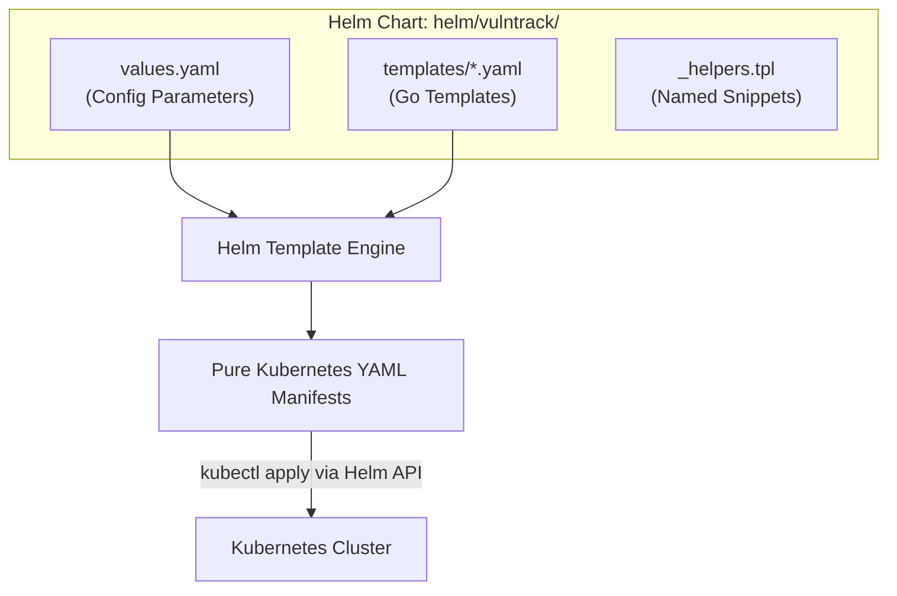
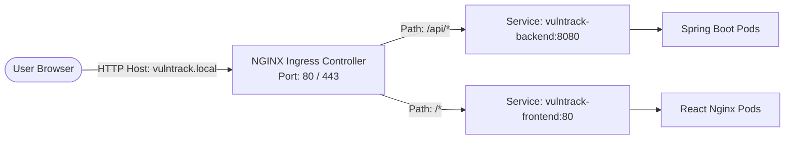
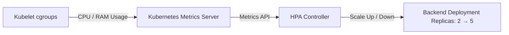

# Chapter 15: Helm Packaging, NGINX Ingress, & Horizontal Pod Autoscaling (HPA)

Managing dozens of raw Kubernetes YAML files across different environments (development, staging, production) leads to code duplication and configuration drift. In this chapter, we explore how VulnTrack packages its workloads using **Helm**, routes ingress traffic with **NGINX Ingress**, and handles dynamic load with **Horizontal Pod Autoscaling (HPA)**.

---

## 1. What is Helm and Why Use It?

**Helm** is the package manager for Kubernetes (equivalent to Maven for Java or npm for Node.js). A packaged application in Helm is called a **Chart**.



### Key Advantages of Helm:
1. **Parameterized Configurations**: Replaces hardcoded values with variables (`{{ .Values.backend.replicaCount }}`).
2. **Environment Overrides**: Switch between local minikube and cloud production with a single flag:
   ```bash
   helm install vulntrack ./vulntrack -f values-prod.yaml
   ```
3. **Atomic Upgrades & Instant Rollbacks**: Every release creates an incremented revision. If a deployment causes failures:
   ```bash
   helm rollback vulntrack 1 -n vulntrack
   ```
   Kubernetes restores the previous working state in under 5 seconds.

---

## 2. Helm Go Templating Mechanics

Inside `helm/vulntrack/templates/`, YAML files contain Go template directives:

```yaml
apiVersion: apps/v1
kind: Deployment
metadata:
  name: {{ include "vulntrack.fullname" . }}-backend
  labels:
    {{- include "vulntrack.labels" . | nindent 4 }}
spec:
  replicas: {{ .Values.backend.replicaCount }}
```

### Important Go Templating Functions:
- **`{{-` and `-}}`**: Trims leading or trailing whitespace to ensure valid YAML indentation.
- **`| default "value"`**: Sets a fallback default if the key is missing in `values.yaml`.
- **`| nindent 4`**: Formats and indents a block of YAML by 4 spaces.
- **`include "template.name" .`**: Injects shared snippets defined in `_helpers.tpl`.

### Validating Charts Locally:
Before applying to a cluster, always run:
```powershell
cd helm
helm lint vulntrack
helm template vulntrack ./vulntrack --debug
```
`helm template` renders the final YAML to your terminal without touching the cluster, letting you inspect syntax and variables beforehand.

---

## 3. Ingress Architecture (NGINX Ingress Controller)

Instead of exposing every pod directly using high-port `NodePort` (e.g., `31234`) or provisioning expensive cloud load balancers for each microservice, an **Ingress Controller** acts as an intelligent HTTP/HTTPS reverse proxy and API Gateway.



### Ingress Resource vs. Ingress Controller
- **Ingress Resource (`templates/ingress.yaml`)**: A Kubernetes configuration object declaring routing rules (paths, hosts, SSL certificates).
- **Ingress Controller (NGINX Ingress)**: The actual running daemon (pod) that listens on ports 80/443, reads Ingress resources, and dynamically configures an internal NGINX reverse proxy to route traffic.

### Ingress Routing Rules in VulnTrack:
```yaml
spec:
  ingressClassName: nginx
  rules:
    - host: "vulntrack.local"
      http:
        paths:
          - path: /api
            pathType: Prefix
            backend:
              service:
                name: vulntrack-backend
                port:
                  number: 8080
          - path: /
            pathType: Prefix
            backend:
              service:
                name: vulntrack-frontend
                port:
                  number: 80
```

---

## 4. Horizontal Pod Autoscaler (HPA)

The **Horizontal Pod Autoscaler (HPA)** automatically adjusts the number of pod replicas in response to real-time CPU or memory utilization.



### The Mathematical Autoscaling Algorithm
The Kubernetes HPA calculates desired replicas using the following formula:
$$\text{Desired Replicas} = \left\lceil \text{Current Replicas} \times \left( \frac{\text{Current Metric Value}}{\text{Target Metric Value}} \right) \right\rceil$$

*Example*: If you have 2 pods with 140% CPU usage and a target of 70%:
$$\text{Desired Replicas} = \left\lceil 2 \times \left( \frac{140}{70} \right) \right\rceil = 4 \text{ pods}$$

### VulnTrack HPA Definition (`templates/hpa.yaml`):
```yaml
spec:
  scaleTargetRef:
    apiVersion: apps/v1
    kind: Deployment
    name: vulntrack-backend
  minReplicas: 2
  maxReplicas: 5
  metrics:
    - type: Resource
      resource:
        name: cpu
        target:
          type: Utilization
          averageUtilization: 70
```

### Demonstrating HPA to College Examiners:
1. **Inspect current HPA baseline**:
   ```powershell
   kubectl get hpa -n vulntrack
   ```
2. **Generate synthetic HTTP load**:
   ```powershell
   kubectl run load-generator --image=busybox --restart=Never -n vulntrack -- /bin/sh -c "while true; do wget -q -O- http://vulntrack-backend:8080/api/assets; done"
   ```
3. **Watch the live scaling**:
   ```powershell
   kubectl get hpa -n vulntrack --watch
   ```
   Within 45 seconds, CPU utilization exceeds 70%, and Kubernetes automatically scales the backend deployment from 2 to 5 pods.
4. **Clean up load generator**:
   ```powershell
   kubectl delete pod load-generator -n vulntrack
   ```
   The HPA will automatically scale back down to 2 pods after the cooldown period (stabilization window: default 5 minutes).

---

## 5. Viva & Interview Questions on Helm, Ingress, & HPA

1. **Q: What is the difference between `helm install` and `helm upgrade --install`?**
   - **Answer**: `helm install` fails if the release already exists. `helm upgrade --install` is idempotent: it installs the chart if it doesn't exist, or upgrades it if it is already present. This is the preferred command in CI/CD pipelines.
2. **Q: What is the difference between Horizontal Pod Autoscaling and Vertical Pod Autoscaling?**
   - **Answer**:
     - **Horizontal Pod Autoscaling (HPA)**: Scales **out** by adding more pod replicas. Ideal for stateless web services.
     - **Vertical Pod Autoscaling (VPA)**: Scales **up** by increasing the CPU and RAM limits of individual pods (requires pod restarts).
3. **Q: Why does HPA fail if resource requests are omitted?**
   - **Answer**: Percentage utilization is calculated as $\frac{\text{Actual Usage}}{\text{Requested Value}} \times 100\%$. If `resources.requests.cpu` is not specified, the denominator is zero/undefined, and HPA cannot calculate the percentage.
