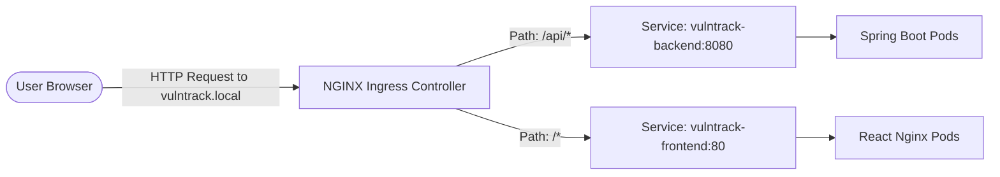

# Chapter 15: Helm Packaging, NGINX Ingress, & Horizontal Pod Autoscaling (HPA)

Managing dozens of raw Kubernetes YAML files across different environments (development, staging, production) leads to code duplication. In this chapter, we explore how VulnTrack packages its workloads using **Helm**, routes ingress traffic with **NGINX Ingress**, and handles dynamic load with **Horizontal Pod Autoscaling (HPA)**.

---

## 1. What is Helm and Why Use It?

**Helm** is the package manager for Kubernetes (equivalent to Maven for Java or npm for Node.js):
- **Templates + Values**: Replaces hardcoded values with variables (`{{ .Values.backend.replicaCount }}`).
- **Environment Overrides**: Use `values-dev.yaml` or `values-prod.yaml` without changing YAML templates.
- **Atomic Upgrades & Rollbacks**: Every deployment creates a versioned revision. If a bad release occurs:
  ```powershell
  helm rollback vulntrack 1 -n vulntrack
  ```

---

## 2. Ingress Architecture (NGINX Ingress)

Instead of exposing every pod directly using high-port `NodePort` (e.g., 31234) or provisioning expensive cloud load balancers for each microservice, an **Ingress Controller** acts as an intelligent HTTP reverse proxy:



### Ingress Rules in VulnTrack (`templates/ingress.yaml`):
```yaml
spec:
  ingressClassName: nginx
  rules:
    - host: "vulntrack.local"
      http:
        paths:
          - path: /api
            pathType: Prefix
            backend:
              service:
                name: vulntrack-backend
                port:
                  number: 8080
          - path: /
            pathType: Prefix
            backend:
              service:
                name: vulntrack-frontend
                port:
                  number: 80
```

---

## 3. Horizontal Pod Autoscaler (HPA)

The **Horizontal Pod Autoscaler (HPA)** automatically adjusts the number of pod replicas in response to CPU or memory utilization.

### Prerequisites for HPA:
1. **Resource Requests must be defined**: Without `requests.cpu: 150m` in the deployment, the HPA cannot calculate percentage utilization!
2. **Metrics Server**: The Kubernetes cluster must have `metrics-server` installed to collect CPU/memory metrics from kubelet.

### Scaling Policy (`templates/hpa.yaml`):
```yaml
spec:
  scaleTargetRef:
    apiVersion: apps/v1
    kind: Deployment
    name: vulntrack-backend
  minReplicas: 2
  maxReplicas: 5
  metrics:
    - type: Resource
      resource:
        name: cpu
        target:
          type: Utilization
          averageUtilization: 70
```

### How to Demonstrate HPA to Examiners:
1. Check current HPA status:
   ```powershell
   kubectl get hpa -n vulntrack
   ```
2. Generate synthetic HTTP load:
   ```powershell
   kubectl run load-generator --image=busybox --restart=Never -n vulntrack -- /bin/sh -c "while true; do wget -q -O- http://vulntrack-backend:8080/api/assets; done"
   ```
3. Watch the HPA scale up:
   ```powershell
   kubectl get hpa -n vulntrack --watch
   ```
   Within 60 seconds, CPU utilization exceeds 70%, and the HPA automatically provisions additional backend pods (from 2 up to 5).
