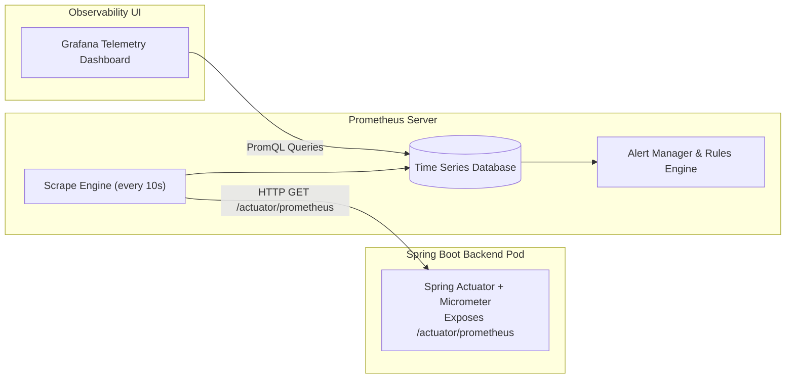

# Chapter 16: Prometheus, Grafana, & Cloud-Native Observability

Deploying applications into production is only half the battle. If an API begins throwing 500 errors or leaking JVM memory at 2:00 AM, how do engineers find out before customers complain? In this chapter, we explore how **Prometheus** and **Grafana** provide real-time observability for VulnTrack.

---

## 1. The Prometheus Pull Model & Spring Boot Actuator

Unlike legacy push-based logging systems where applications push logs over sockets, **Prometheus** uses a **Pull-Based (Scraping) Model**:



### Why Micrometer Prometheus?
By including `micrometer-registry-prometheus` in [backend/pom.xml](file:///c:/Users/LENOVO/Documents/Desktop/desk/3rd%20year/Devops/Devops%20Project/backend/pom.xml), Spring automatically instruments:
- Every HTTP route and response status code.
- Garbage collection pauses and memory pools.
- HikariCP active database connections and pool wait times.

---

## 2. Key PromQL Queries Used in VulnTrack

### 1. API Request Throughput (Requests per Second)
```promql
sum(rate(http_server_requests_seconds_count[1m])) by (uri)
```
Calculates per-route request volume per second over a 1-minute rolling window.

### 2. P95 Request Latency (Percentile)
```promql
histogram_quantile(0.95, sum(rate(http_server_requests_seconds_bucket[1m])) by (le))
```
Answers: *"What is the maximum response time experienced by 95% of our users?"*

### 3. JVM Heap Memory Utilization
```promql
jvm_memory_used_bytes{area="heap"} / jvm_memory_max_bytes{area="heap"} * 100
```
Calculates percentage of allocated JVM heap memory currently occupied by live objects.

---

## 3. Automated Alerting Rules (`alert-rules.yaml`)

Prometheus continuously evaluates alerting rules:
1. **`VulnTrackBackendDown`**: Fires if the backend cannot be reached for > 1 minute.
2. **`HighHttp5xxErrorRate`**: Fires if server error rates exceed 5% of total requests over 2 minutes.
3. **`HighJvmHeapUsage`**: Fires if memory consumption stays above 85% for 3 minutes.

---

## 4. How to Verify Metrics Are Collected

1. Access the raw metrics endpoint directly:
   ```powershell
   curl http://localhost:8080/actuator/prometheus
   ```
2. You will observe lines of Prometheus metrics:
   ```text
   # HELP http_server_requests_seconds Duration of HTTP server request handling
   # TYPE http_server_requests_seconds histogram
   http_server_requests_seconds_count{method="GET",status="200",uri="/api/dashboard"} 42.0
   ```
3. Open Grafana at `http://localhost:3000` (or cluster NodePort) and import `monitoring/grafana/dashboard-vulntrack.json` to view real-time graphical telemetry!
