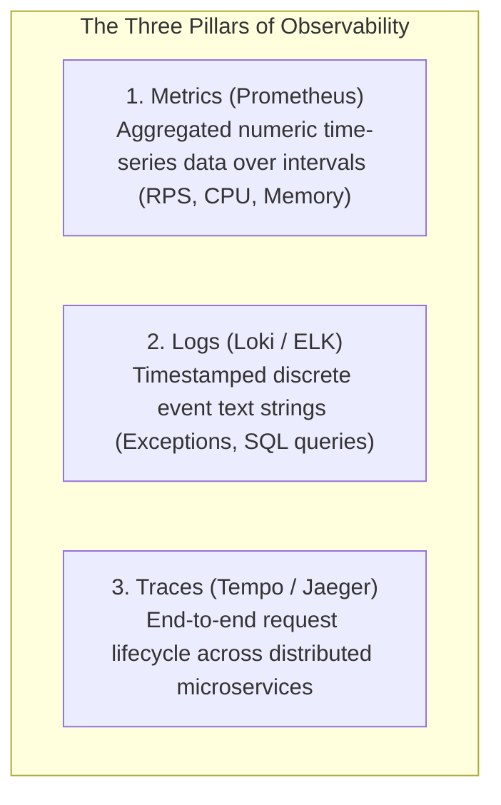
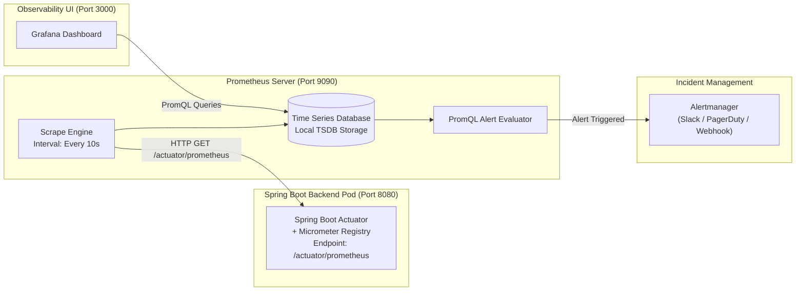

# Chapter 16: Prometheus, Grafana, & Cloud-Native Observability

Deploying applications into production is only half the battle. If an API begins throwing 500 Internal Server Errors or leaking JVM heap memory at 2:00 AM, how do engineers find out before customers complain? In this chapter, we explore how **Prometheus** and **Grafana** provide real-time observability for VulnTrack.

---

## 1. The Three Pillars of Observability

In cloud-native engineering, observability is built upon three foundational pillars:



VulnTrack instruments production-grade **Metrics** using Prometheus and Grafana.

---

## 2. The Prometheus Pull Architecture vs. Push Model

Unlike legacy monitoring systems that require applications to push logs over TCP/UDP sockets to a central server (which risks crashing the server if thousands of agents push simultaneously), **Prometheus** uses a **Pull-Based (Scraping) Model**:



### Why Micrometer in Spring Boot?
In [backend/pom.xml](file:///c:/Users/LENOVO/Documents/Desktop/desk/3rd%20year/Devops/Devops%20Project/backend/pom.xml), we included `io.micrometer:micrometer-registry-prometheus`. Micrometer acts like "SLF4J for metrics" — an abstraction vendor layer that automatically instruments:
- Every HTTP request duration, route path, and status code.
- JVM Garbage Collection pauses, thread counts, and memory pool allocations.
- HikariCP database connection pool metrics (active, idle, and pending connections).

---

## 3. Metric Types in Prometheus

Prometheus stores all metrics as time-series data using four fundamental data types:

| Metric Type | Description | Real Example in VulnTrack |
| :--- | :--- | :--- |
| **Counter** | Cumulative metric that only increases or resets to zero upon restart | `http_server_requests_seconds_count` (Total requests served) |
| **Gauge** | Numeric value that can go up and down | `jvm_memory_used_bytes` (Heap RAM used right now) |
| **Histogram** | Samples observations into configurable buckets and counts occurrences | `http_server_requests_seconds_bucket` (Request duration percentiles) |
| **Summary** | Similar to histogram, but calculates configurable quantiles on client-side | Request execution summaries |

---

## 4. The RED Method for Monitoring Web Applications

Google Site Reliability Engineers (SRE) and cloud architects evaluate web applications using the **RED Method**:
- **R - Rate**: The number of requests our application is serving per second.
- **E - Errors**: The number of requests that fail (HTTP 4xx / 5xx).
- **D - Duration**: The amount of time each request takes to complete.

### Essential PromQL Queries in VulnTrack:

#### 1. Request Rate (R)
```promql
sum(rate(http_server_requests_seconds_count[1m])) by (uri)
```
*Meaning*: Computes the per-second rate of incoming HTTP requests for each API endpoint over a 1-minute window.

#### 2. Error Rate Percentage (E)
```promql
(sum(rate(http_server_requests_seconds_count{status=~"5.."}[1m])) 
 / 
 sum(rate(http_server_requests_seconds_count[1m]))) * 100
```
*Meaning*: Calculates what percentage of incoming traffic is resulting in HTTP 500 errors.

#### 3. P95 and P99 Latency (D)
```promql
histogram_quantile(0.95, sum(rate(http_server_requests_seconds_bucket[1m])) by (le))
```
*Meaning*: Calculates 95th percentile latency. If P95 is 120ms, 95% of users receive their responses in under 120ms.

---

## 5. Automated Alerting Rules (`monitoring/prometheus/alert-rules.yaml`)

Prometheus evaluates rules every 15 seconds against collected telemetry:

```yaml
groups:
  - name: vulntrack_alerts
    rules:
      - alert: VulnTrackBackendDown
        expr: up{job="vulntrack-backend"} == 0
        for: 1m
        labels:
          severity: critical
        annotations:
          summary: "VulnTrack Backend instance is down!"
          description: "Pod has been unreachable for more than 60 seconds."

      - alert: HighHttp5xxErrorRate
        expr: (sum(rate(http_server_requests_seconds_count{status=~"5.."}[2m])) / sum(rate(http_server_requests_seconds_count[2m]))) * 100 > 5
        for: 2m
        labels:
          severity: warning
        annotations:
          summary: "High HTTP 5xx error rate detected"
          description: "Over 5% of API requests are failing with 5xx status codes."

      - alert: HighJvmHeapUsage
        expr: (jvm_memory_used_bytes{area="heap"} / jvm_memory_max_bytes{area="heap"}) * 100 > 85
        for: 3m
        labels:
          severity: warning
        annotations:
          summary: "JVM Heap usage exceeded 85%"
          description: "Application is close to an OutOfMemoryError."
```

---

## 6. How to Inspect Live Telemetry

1. **Verify Raw Prometheus Metrics**:
   ```powershell
   curl http://localhost:8080/actuator/prometheus
   ```
2. **Access Grafana**:
   Open your browser to `http://localhost:3000` (default credentials: `admin / admin`).
3. **Import VulnTrack Dashboard**:
   Go to **Dashboards → New → Import**, upload [`monitoring/grafana/dashboard-vulntrack.json`](file:///c:/Users/LENOVO/Documents/Desktop/desk/3rd%20year/Devops/Devops%20Project/monitoring/grafana/dashboard-vulntrack.json), and connect your Prometheus data source to view real-time graphical panels for Request Rate, Latency, Heap Memory, and Active Vulnerabilities!

---

## 7. Viva & Interview Questions on Observability

1. **Q: Why is Prometheus preferred over traditional SNMP or Nagios for cloud-native apps?**
   - **Answer**: Cloud-native environments have dynamic, ephemeral pods that constantly spin up and down. Prometheus uses Kubernetes service discovery to dynamically discover new pods without requiring static IP configuration in Nagios.
2. **Q: What is the difference between average latency and percentile latency (P95/P99)?**
   - **Answer**: Average latency hides outliers. If 99 users experience 10ms latency and 1 user experiences 10,000ms (10 seconds), the average is ~110ms, which looks acceptable, while the 1 user had an unacceptable experience. P99 latency accurately highlights worst-case user experiences.
3. **Q: How does Prometheus handle scrape failures?**
   - **Answer**: It sets the synthetic metric `up{job="vulntrack-backend"} = 0`. This allows instant alerting via rules when a pod or service becomes unresponsive.
