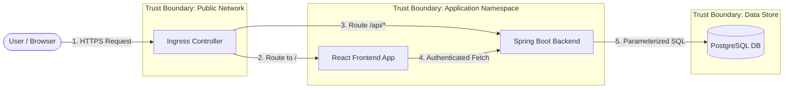

# VulnTrack Application Threat Model

This document outlines the threat modeling assessment for the **VulnTrack** vulnerability tracking system using the industry-standard **STRIDE** methodology (developed by Microsoft).

---

## 1. System Scope & Assets to Protect

### Assets
1. **Asset Inventory Data**: Catalog of organizational applications, hostnames, and environment flags.
2. **Vulnerability Findings**: Critical security records, remediation statuses, and CVE identifiers.
3. **Application Credentials**: Database credentials, administrative session tokens, and API credentials.
4. **Audit Integrity**: Timestamped history of vulnerability remediation and lifecycle updates.

### Trust Boundaries
- **Trust Boundary 1 (Client / External Network → Ingress/Frontend)**: Untrusted browser clients communicating over public/untrusted networks.
- **Trust Boundary 2 (Frontend → Spring Boot Backend API)**: HTTP requests authenticated via credentials/session.
- **Trust Boundary 3 (Backend API → PostgreSQL Database)**: Private VPC/internal cluster network connection.
- **Trust Boundary 4 (Cluster Workloads → Host/Kubernetes Node)**: Container boundary enforced via Linux namespaces, cgroups, and seccomp.

---

## 2. STRIDE Threat Analysis & Mitigations

| Threat Category | Potential Threat Scenario | Severity | Applied Mitigation in VulnTrack |
| :--- | :--- | :--- | :--- |
| **S - Spoofing** | Attacker attempts to impersonate an administrator to delete vulnerability records or modify status. | **High** | Strong password hashing (BCrypt with cost factor 12), Role-Based Access Control (`ROLE_ADMIN` vs `ROLE_VIEWER`), credential verification on every mutating request. |
| **T - Tampering** | Attacker attempts SQL injection to alter database tables or bypass validation constraints. | **High** | Safe ORM parameterized queries via Spring Data JPA. Request validation using Bean Validation (`@Valid`, `@Pattern`) preventing malicious payload manipulation. |
| **R - Repudiation** | User claims they did not mark a critical vulnerability as 'FIXED'. | **Medium** | Automated timestamping (`created_at`, audit tracking), structured logging of security-relevant lifecycle events without sensitive data leaks. |
| **I - Information Disclosure** | Unauthenticated user views internal IP addresses, asset metadata, or detailed system stack traces. | **High** | Spring Security blocks unauthenticated access to business endpoints (`401 Unauthorized`). Custom `GlobalExceptionHandler` intercepts exceptions and returns sanitized JSON error schemas rather than Java stack traces. |
| **D - Denial of Service** | Malicious actor spams high-volume requests to overwhelm backend CPU or memory. | **High** | Kubernetes Horizontal Pod Autoscaler (HPA) automatically scales backend replicas based on CPU target (70%). Resource limits (`limits.memory`, `limits.cpu`) prevent noisy-neighbor pod starvation. |
| **E - Elevation of Privilege** | A user with `ROLE_VIEWER` attempts to invoke `POST /api/vulnerabilities` or `DELETE /api/assets/{id}`. | **High** | Method security and URL filter chains restrict mutating HTTP methods (`POST`, `PUT`, `PATCH`, `DELETE`) strictly to `hasRole('ADMIN')`. Any violation triggers an immediate `403 Forbidden` response. |

---

## 3. Data Flow Diagram (DFD)

---

## 4. Residual Risks & Future Mitigations

1. **OAuth2 / OIDC Integration**: Future iterations can replace HTTP Basic authentication with enterprise identity providers (Keycloak, Okta) utilizing JWT tokens with short expiry and refresh tokens.
2. **NetworkPolicies**: Local development Kubernetes clusters can enable Calico or Cilium to enforce namespace egress/ingress network policies restricting database access strictly to the backend pod.
